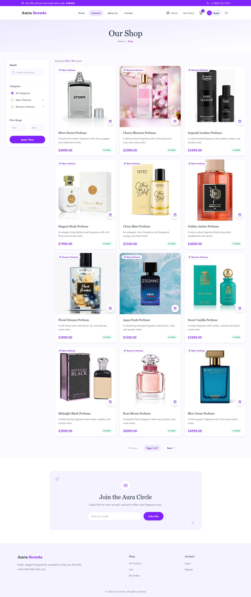
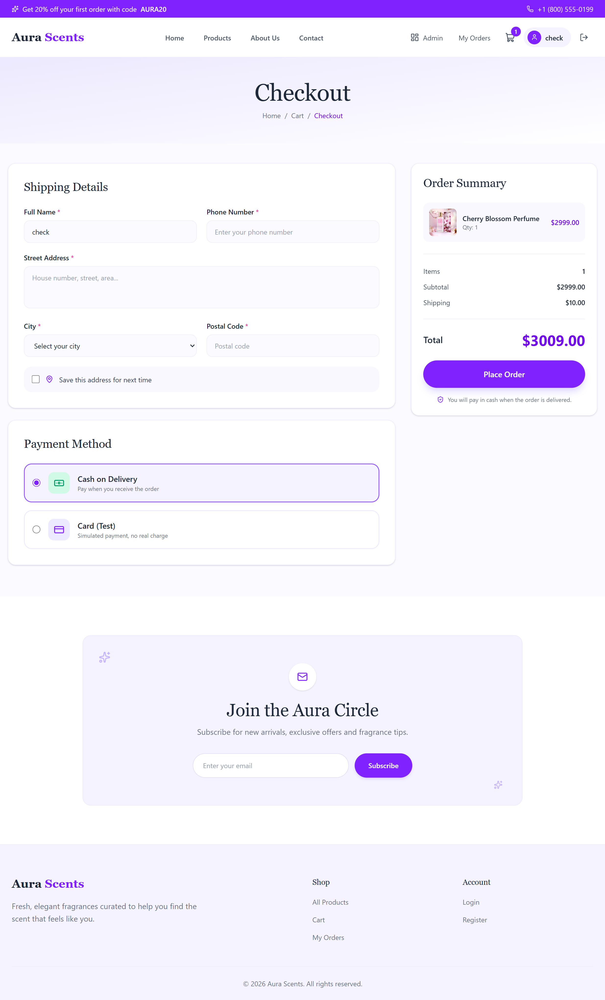
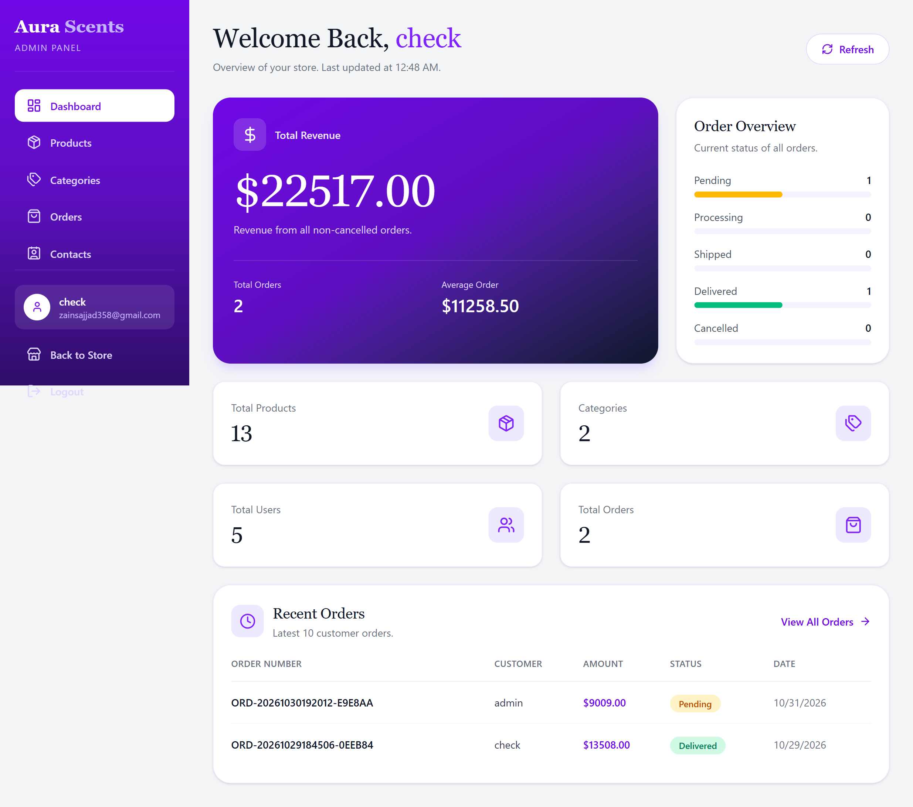
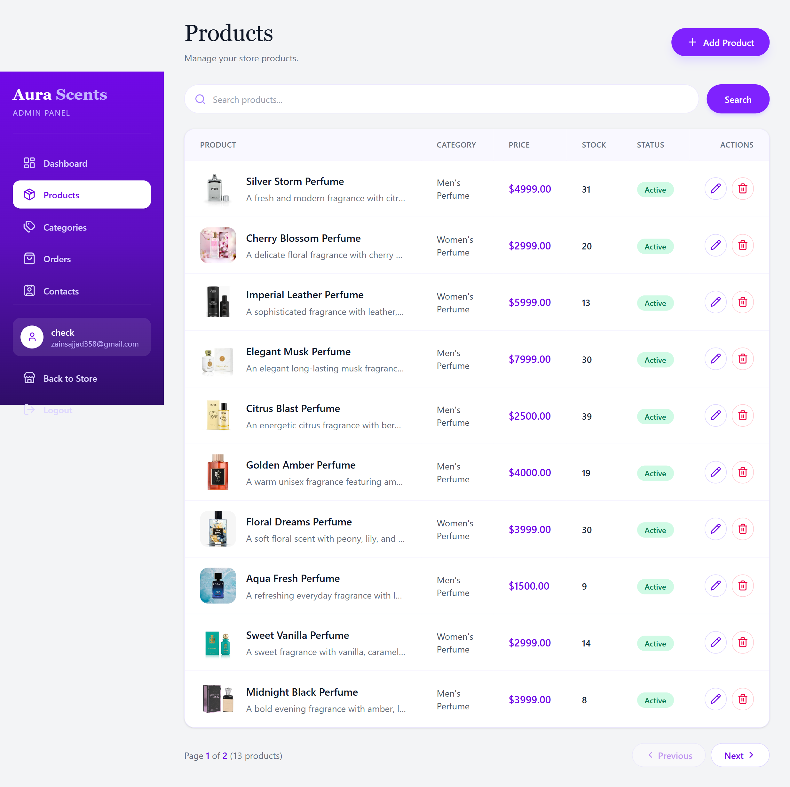

# AuraScents Client

React frontend for **AuraScents**, a full-stack perfume e-commerce application. Built with React, TypeScript, Tailwind CSS and Vite, and connected to an ASP.NET Core Web API.

**Live demo:** https://ecommerce-client-orpin-kappa.vercel.app
**Backend repo:** https://github.com/MuhammadZayne358/ecommerce-api









## Features

**Shop**
- Home, About and Contact pages
- Product listing with pagination, product details, reviews and ratings
- Shopping cart
- Checkout with Cash on Delivery or Card (demo only)
- Auto-filled name for logged-in users and a saved address book: pick a saved address, add a new one, set a default or delete addresses
- Order history, order details and order success page
- Register, login, forgot password and reset password
- User profile

**Admin panel**
- Dashboard
- Manage products (create, edit, image upload) and categories
- View and manage orders
- Read contact messages
- Protected routes, only accessible to admin users

## Tech stack

| Area | Technology |
| --- | --- |
| UI | React 19, TypeScript |
| Build tool | Vite |
| Styling | Tailwind CSS 4 |
| Routing | React Router 7 |
| HTTP | Axios |
| Icons | Lucide React |
| Hosting | Vercel |

## Project structure

```
src/
├── api/        # Axios instance and API functions (productApi, cartApi, orderApi, addressApi, ...)
├── components/ # Reusable components
├── context/    # Auth and cart state (React Context)
├── pages/
│   ├── shop/   # Customer pages
│   ├── auth/   # Login, register, password reset
│   └── admin/  # Admin panel pages
├── routes/     # App routes and protected routes
└── types/      # TypeScript types
```

## Getting started

### Prerequisites
- Node.js 18 or newer
- The [AuraScents API](https://github.com/MuhammadZayne358/ecommerce-api) running locally

### Run locally

```bash
git clone https://github.com/MuhammadZayne358/ecommerce-client.git
cd ecommerce-client
npm install
```

Create a `.env` file in the project root with the address of your local API:

```
VITE_API_URL=https://localhost:YOUR_API_PORT/api
```

Then start the dev server:

```bash
npm run dev
```

The app runs on `http://localhost:5174`.

### Scripts

| Command | Description |
| --- | --- |
| `npm run dev` | Start the development server |
| `npm run build` | Type-check and build for production |
| `npm run lint` | Run ESLint |

## Deployment

The app is deployed on Vercel. A `vercel.json` file forwards `/api` and `/images` requests to the backend and sends every other route to `index.html`, so React Router works on page refresh.

In Vercel, set this environment variable:

```
VITE_API_URL=/api
```

Because the browser only talks to the Vercel domain, the login cookie is a first-party cookie and works on browsers that block third-party cookies.

## Notes

- The backend runs on a free hosting plan, so the first request after a period of inactivity can be slow.
- The card payment option is a demo and no real payments are processed.

## Author

**Muhammad Zain**, .NET and React developer
GitHub: [@MuhammadZayne358](https://github.com/MuhammadZayne358)
